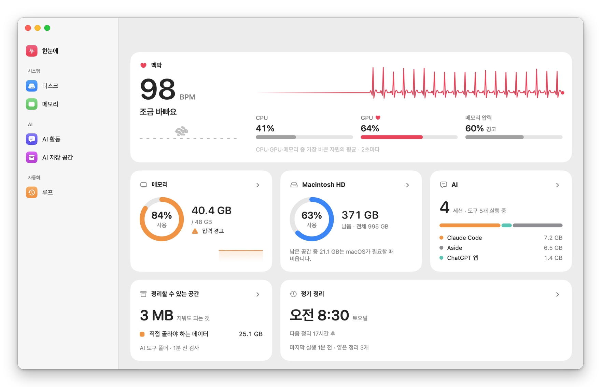
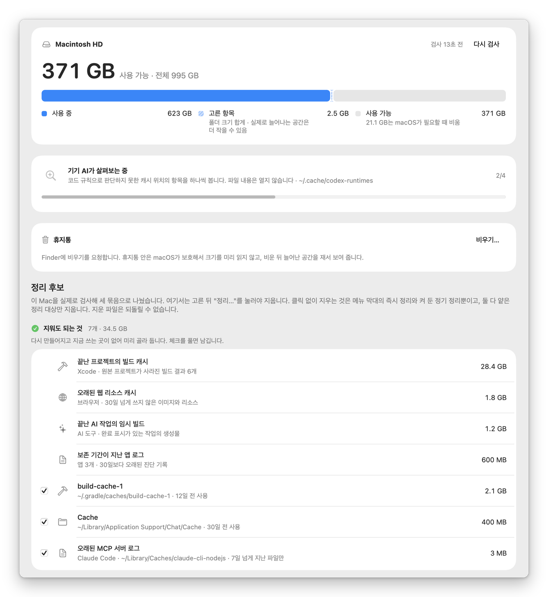
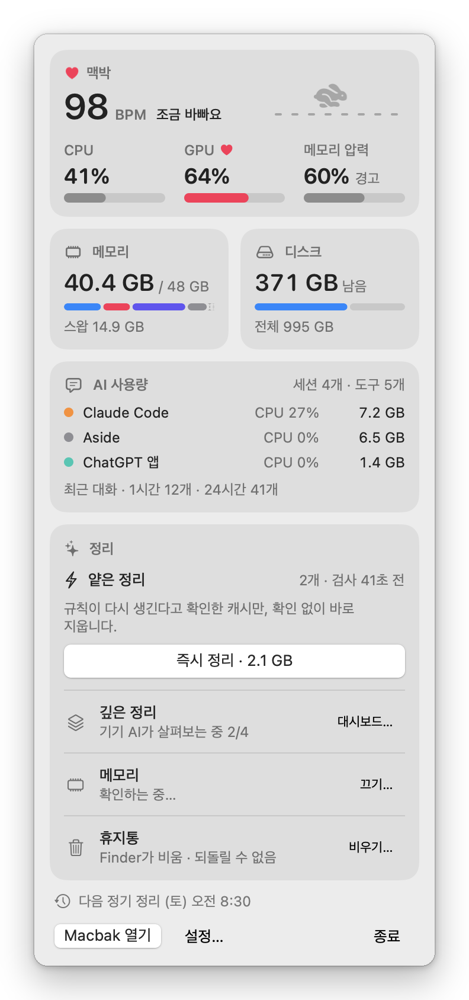
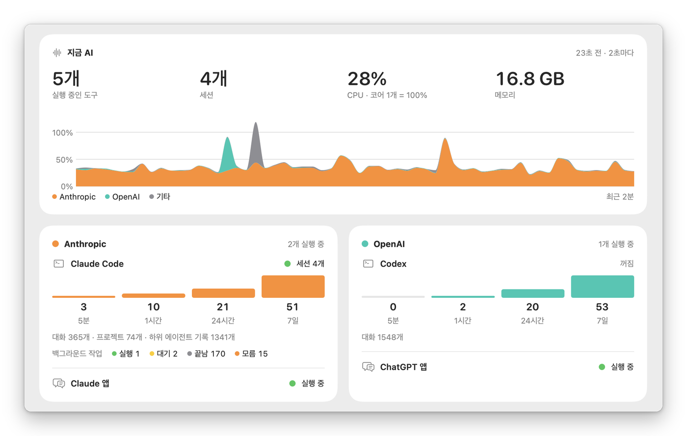

# Macbak

<picture>
  <source media="(prefers-color-scheme: dark)" srcset="docs/screenshots/glance-dark.png">
  
</picture>

내 Mac의 상태를 한눈에 보는 macOS 앱입니다. 디스크와 메모리, AI 도구 사용량을 실시간으로 보여 주고 쌓인 캐시는 이 Mac을 직접 검사해 지워도 되는 것만 골라 정리합니다. 이름은 한국어 "맥박"을 영문으로 적은 것입니다.

## 할 수 있는 일

- 맥박은 CPU, GPU, 메모리 압력 가운데 가장 바쁜 자원을 박동수로 바꾼 값입니다. 모두 쉬면 60, 하나라도 꽉 차면 120입니다.
- 디스크 정리는 Xcode 캐시, 앱 캐시와 로그, 기기 지원 파일, 시뮬레이터, AI 도구 캐시를 검사해 "지워도 되는 것", "골라서 지울 것", "지우면 안 되는 것"으로 나눕니다.
- 메모리 정리는 아무도 쓰지 않는데 켜진 채 남은 시뮬레이터를 끕니다. 지금 쓰는 앱은 건드리지 않습니다.
- AI 활동 화면은 Claude Code, Codex, Gemini CLI 같은 도구의 세션과 CPU, 메모리, 저장 공간을 제조사별로 보여 줍니다.
- 메뉴 막대 패널에서 상태를 바로 보고 다시 생기는 캐시는 버튼 하나로 지웁니다.
- 정기 정리를 켜 두면 정해진 시각마다 검사하고 다시 생기는 캐시만 지웁니다.

정리는 휴지통을 거치지 않고 바로 지우므로 되돌릴 수 없습니다. 그래서 지울 목록을 먼저 보여 주고 지우기 직전에 줄마다 다시 확인합니다. 쓰는 중이거나 확인할 수 없는 것은 지우지 않습니다.

## 화면

디스크 화면(왼쪽)은 정리 후보를 세 묶음으로 보여 주고 메뉴 막대 패널(오른쪽)은 한눈에 화면을 줄여 담습니다. 디스크 화면의 정리 목록은 예시 데이터입니다.

<p align="center">
  <picture>
    <source media="(prefers-color-scheme: dark)" srcset="docs/screenshots/disk-dark.png">
    
  </picture>
  <picture>
    <source media="(prefers-color-scheme: dark)" srcset="docs/screenshots/menubar-dark.png">
    
  </picture>
</p>

AI 활동 화면은 실행 중인 AI 도구의 CPU 사용량을 제조사별로 쌓아 그리고 도구마다 세션과 최근 대화 수를 보여 줍니다.

<p align="center">
  <picture>
    <source media="(prefers-color-scheme: dark)" srcset="docs/screenshots/ai-activity-dark.png">
    
  </picture>
</p>

## 설치

Apple silicon Mac과 macOS 14 이상이 필요합니다. Liquid Glass 디자인은 macOS 26 이상에서 보이고 기기 AI가 캐시를 판단하는 기능은 macOS 26 이상에서 Apple Intelligence를 쓸 수 있을 때만 동작합니다.

1. [Releases](../../releases/latest)에서 `Macbak-<버전>.dmg`를 받습니다.
2. DMG를 열어 Macbak을 Applications 폴더로 끌어 놓습니다.
3. 로컬 서명만 하고 공증하지 않은 앱이라 다른 Mac에서 처음 열 때 macOS가 한 번 막습니다. 그때는 시스템 설정의 개인정보 보호 및 보안에서 "그래도 열기"를 누릅니다.

소스에서 직접 빌드할 수도 있습니다.

```bash
bash scripts/build-app.sh    # dist/Macbak.app 빌드
bash scripts/make-dmg.sh     # dist/Macbak-<버전>.dmg 만들기
open dist/Macbak.app
```

## 개인정보

검사와 기기 AI 판단은 모두 이 Mac 안에서 하고 검사 결과와 파일 정보는 밖으로 보내지 않습니다.

- 프로세스는 이름, 실행 경로, `argv[0]`만 읽습니다. node 같은 런타임일 때만 스크립트 경로 하나를 더 읽고 비밀값이 들어 있을 수 있는 나머지 인자는 읽지 않습니다.
- AI 대화 기록은 파일 이름과 수정 시각만 읽고 내용은 열지 않습니다. 백그라운드 작업은 `state.json`의 `state` 값 하나만 읽습니다.
- 기기 AI는 캐시 항목의 이름, 크기, 날짜만 보고 파일 내용은 읽지 않습니다.
- 사용 여부를 확인할 수 없으면 "안 쓴다"고 가정하지 않고 보호합니다. 창이 가려졌다가 다시 보일 때도 실행 목록을 새로 읽은 뒤에야 판정합니다.

## 문서

자세한 동작과 판정 규칙은 `docs/`에 있습니다.

- [화면과 맥박](docs/screens.md)은 화면마다 무엇을 보여 주는지와 맥박을 계산하는 방법을 설명합니다.
- [정리](docs/cleanup.md)는 대상별 판정 기준과 안전 장치, 메모리와 휴지통 정리, 정기 정리를 설명합니다.
- [메뉴 막대](docs/menubar.md)는 표시 조합과 패널 구성을 설명합니다.
- [AI 도구 추가하기](docs/ai-tools.md)는 새 AI 도구를 카탈로그 항목 하나로 지원하는 방법입니다.
- [개발 기록](docs/development.md)에는 디자인 기준, 성능 측정, 검증 기록, 코드 구조가 있습니다.

테스트는 `swift test`로 돌립니다.
